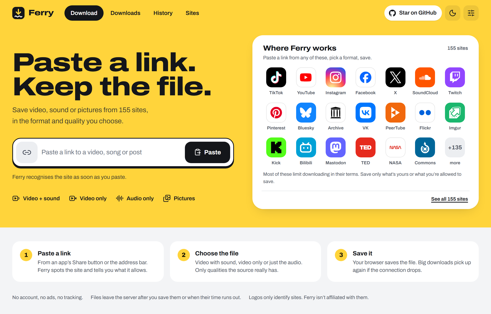
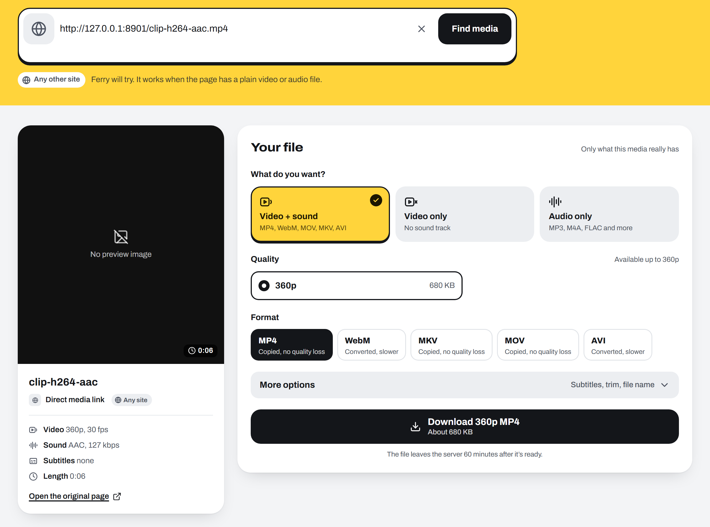
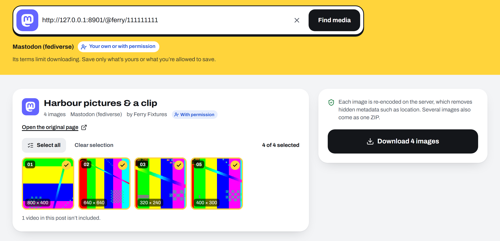
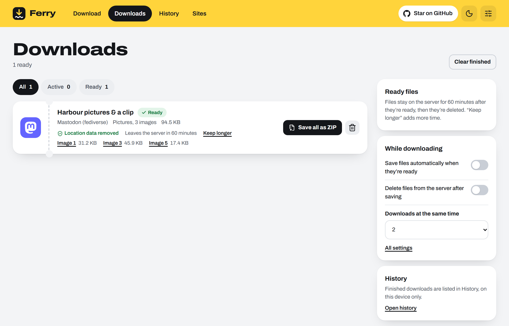
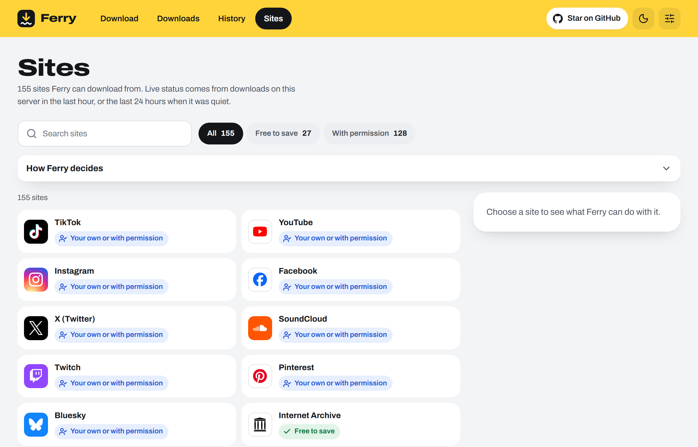
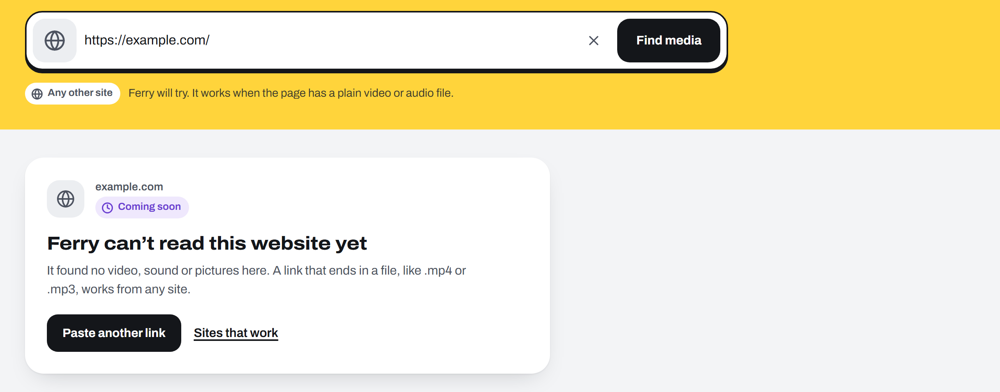
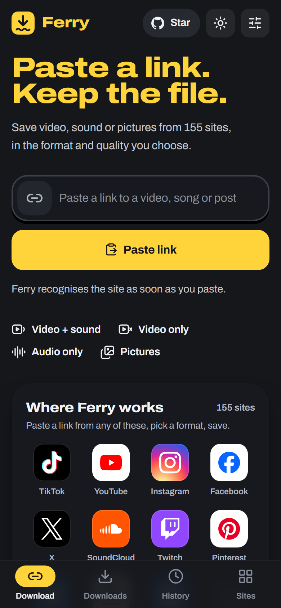
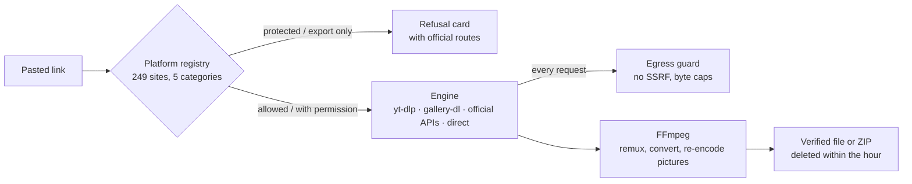

<div align="center">

# Ferry

**Paste a link. Keep the file.**

A self-hosted media downloader that turns a link into a clean file (video with sound, video only,
audio only, or pictures) in the format and quality you choose, and tells you plainly what each
site allows.




</div>

## Contents

- [Why Ferry](#why-ferry)
- [Screenshots](#screenshots)
- [What you can save](#what-you-can-save)
- [Quick start](#quick-start-development)
- [Configuration](#configuration)
- [Tests](#tests)
- [Deploy](#deploy)
- [How it works](#how-it-works)
- [Repository](#repository)
- [Documentation](#documentation)
- [Legal](#legal)

## Why Ferry

| | |
|---|---|
| **Honest about quality** | Ferry offers only the qualities the source really has, shows sizes only when they're known, and never upscales. It warns when a conversion can't add quality, and every file says whether it was *copied* or *converted*. |
| **Rules built in** | A registry of 249 platforms in five permission categories, checked before anything is fetched and changeable while the server runs. Protected and paid content stays protected. YouTube, Facebook, SoundCloud and other sites whose terms restrict downloading are marked *With permission*. |
| **Clear when a link doesn't work** | The card names the site, says what happened, lists what does work there, and offers one next step. Picture posts on video-first sites say *Coming soon*. Sites that need a sign-in say so, because Ferry never signs in. |
| **Pictures too** | Image posts, albums and carousels open as a picture grid. You choose the images and get clean copies, with hidden metadata such as location removed, plus one ZIP. |
| **Private** | No accounts, ads or trackers. History stays on your device. Files leave the server within the hour, or right after you save them. |
| **Secure** | Every engine connection goes through an egress guard (no SSRF, no DNS rebinding, per-job byte caps). No shell execution, and hardened yt-dlp, gallery-dl and FFmpeg profiles. |
| **Mobile-first** | One-handed layout with bottom tabs, Android share-to-Ferry, resumable native downloads, an iOS Home Screen workaround, and light and dark themes. English only. |

## Screenshots

<table>
  <tr>
    <td width="50%"><br><sub><b>A video:</b> only the qualities it really has, and the format you want.</sub></td>
    <td width="50%"><br><sub><b>A picture post:</b> pick the images, get one ZIP.</sub></td>
  </tr>
  <tr>
    <td width="50%"><br><sub><b>Downloads:</b> progress, ready files, and when they leave the server.</sub></td>
    <td width="50%"><br><sub><b>Sites:</b> what Ferry does with each site, with live status.</sub></td>
  </tr>
  <tr>
    <td width="50%"><br><sub><b>When a link doesn't work:</b> what happened and what to do next.</sub></td>
    <td width="50%" align="center"><br><sub><b>On a phone,</b> in dark mode.</sub></td>
  </tr>
</table>

The screenshots come from the local test stack, which uses only self-made test media. To
regenerate them: `npm run build && node scripts/screenshots.mjs`.

## What you can save

| You want | You get |
|---|---|
| **Video with sound** | MP4, WebM, MKV, MOV or AVI, at any quality the source has (up to 4K where offered) |
| **Video only** | The same formats, without the sound track |
| **Audio only** | MP3, M4A, AAC, WAV, FLAC, Opus or OGG |
| **Pictures** | JPEG, PNG or GIF, re-encoded without hidden metadata; several come as one ZIP |

**Sites.** Home and Sites list the **155** sites Ferry can download from on a standard server. Ferry
also tries any other page that has a plain video or audio file, and any link that ends in a media
file. The full list, with each site's rules and engine, is in
[docs/PLATFORM-COMPATIBILITY.md](docs/PLATFORM-COMPATIBILITY.md).

**Pictures** work from Imgur, Flickr, Pexels, Unsplash, DeviantArt, ArtStation, 500px, Behance, VSCO,
SmugMug, ImgBB, Postimages, Wallhaven, Civitai, Pixeldrain, Mastodon posts and Instagram posts
(including carousels). Picture posts on X, Facebook, TikTok and other video-first sites aren't
supported yet; Ferry says *Coming soon* for them instead of failing silently.

**Never:** DRM-protected or paid content (Netflix, Spotify and similar), anything behind a sign-in,
or anything that needs Ferry to pose as a browser.

## Quick start (development)

**Requirements**
- Node 22.12+ (24 recommended)
- Python 3.11+
- FFmpeg and ffprobe. Ferry finds them on `PATH`, or on Windows in the winget, Chocolatey or Scoop
  folders even when the shell predates the install. Otherwise set `FFMPEG_PATH` and `FFPROBE_PATH`.

Without these, Ferry refuses links with a clear "engine unavailable" error.

```bash
npm run setup          # everything: finds Python, creates .venv with pinned yt-dlp + gallery-dl,
                       # npm install, test media, web build (Windows, macOS, Linux)
npm start              # http://127.0.0.1:8787
npm run dev            # API + Vite with hot reload → http://127.0.0.1:5173
```

`npm run setup` options: `--skip-build`, `--skip-fixtures`, `--recreate-venv`. To force a specific
interpreter: `PYTHON=/path/to/python npm run setup` (PowerShell:
`$env:PYTHON="C:\…\python.exe"; npm run setup`).

<details>
<summary><b>Windows: "Python was not found; run without arguments to install from the Microsoft Store"</b></summary>

That message comes from Windows' *App execution aliases* (fake `python.exe`/`python3.exe` that open
the Store), not from Python. `npm run setup` avoids them by using the `py` launcher that the
python.org installer adds. To fix the `python` command itself: *Settings → Apps → Advanced app
settings → App execution aliases*, turn off **python.exe** and **python3.exe**, then open a new
terminal (PATH changes only apply to terminals opened afterwards).

</details>

## Configuration

Copy [`.env.example`](.env.example) to `.env`. Every value has a safe default except
`SIGNING_SECRET`, which production requires. The settings you're most likely to change:

| Setting | Default | What it does |
|---|---|---|
| `SIGNING_SECRET` | *(required in production)* | Signs download and preview links. 32+ random bytes: `openssl rand -base64 48`. |
| `ADMIN_TOKEN` | *(unset)* | Turns on the admin API (`/api/v1/admin/*`) for changing site rules at runtime. |
| `ASK_PERMISSION` | `false` | `true` makes users tick “It’s my content, or I have permission” before downloading from sites whose terms restrict downloading. |
| `MAX_FILESIZE_MB` | `2048` | Largest file a download may produce. |
| `MAX_DURATION_SECONDS` | `10800` | Longest video or audio accepted (3 hours). |
| `JOB_TTL_MINUTES` | `60` | How long ready files stay on the server. |
| `MAX_CONCURRENT_JOBS` | `2` in the example | Downloads processed at the same time. |
| `GALLERYDL_PATH` | `.venv` or `PATH` | Picture engine. Without it, picture-only sites show as unavailable; Instagram pictures still work. |
| `LOG_CLIENT_IP` | `false` | Client IPs are personal data under GDPR; keep this off unless you need it. |

Limits, rate limits and network settings are listed with comments in `.env.example`.

## Tests

```bash
npm run fixtures       # generate self-authored test media with FFmpeg (once)
npm test               # unit + integration (real yt-dlp, gallery-dl and FFmpeg, local fixtures only)
npm run build && npm run test:e2e   # Playwright E2E in the installed Microsoft Edge (PW_CHANNEL=chrome for Chrome)
node scripts/perf.mjs  # performance measurements → docs/PERFORMANCE.md
```

No test downloads third-party media: the fixtures are test patterns and tones generated locally
and served from a loopback server.

## Deploy

### Docker Compose (recommended)

```bash
cp .env.example .env            # set SIGNING_SECRET (openssl rand -base64 48) and FERRY_DOMAIN
docker compose -f deploy/docker-compose.yml --env-file .env up -d --build
```

The container runs as an unprivileged user with a read-only root filesystem, dropped capabilities
and CPU, memory and process limits, behind Caddy with automatic HTTPS. See
[docs/SYSTEM-ARCHITECTURE.md §16](docs/SYSTEM-ARCHITECTURE.md) and the firewall note in
`deploy/docker-compose.yml`.

Operators can restrict or turn off any platform while the server runs:

```bash
curl -X PUT https://ferry.example.com/api/v1/admin/policies/vimeo \
  -H "Authorization: Bearer $ADMIN_TOKEN" -H "content-type: application/json" \
  -d '{"policy":"disabled","reason":"Temporarily unavailable."}'
```

### Vercel (trial)

Vercel can run Ferry's container directly; its container support is in beta. `vercel.json` tells
Vercel to build one container, the `ferry` service, from `Dockerfile.vercel` and to send it every
request. `Dockerfile.vercel` is an exact copy of `deploy/Dockerfile`, so Vercel builds the same
image as Docker Compose. `apps/server/test/unit/vercel-deploy.test.js` checks both files.

1. In Vercel, choose **Add New → Project** and import this repository. Vercel reads `vercel.json`
   and imports Ferry as one project with one service. Don't replace it with the separate `server`
   and `web` services Vercel may suggest for `apps/server` and `apps/web`: on its own, the server
   runs without yt-dlp and FFmpeg, which only the container installs.
2. In **Settings → Environment Variables**, paste the contents of
   [`deploy/vercel.env.example`](deploy/vercel.env.example). Then set `SIGNING_SECRET` to a long
   random value (`openssl rand -base64 48`) and mark it **Sensitive**. Keep `PORT=8787`: without it
   Vercel sends traffic to port 80, which Ferry's locked-down user cannot open.
3. Deploy, then on the preview address (`….vercel.app`):
   - open `/readyz`: it should say `"ready"`. If `disk` is `false`, lower `MIN_FREE_DISK_MB`;
   - paste a link to your own or Creative Commons media, and download a short file.

What to expect from the trial:

- **One copy holds everything.** Jobs and finished files live in the one running copy of Ferry. If
  Vercel starts a second copy, a download can show "not found". After 5 minutes without visitors,
  Vercel stops the copy and its files are gone. Sites switched off through the admin API also
  reset then, because those changes are saved on the copy's disk.
- **Time limits.** Vercel ends every request after 5 minutes on the free plan (up to about 13 minutes
  on Pro), file downloads included. That is why `deploy/vercel.env.example` lowers the size and
  length limits.
- **Free plan allowance:** 4 hours of CPU time a month, 2 GB of memory and 1 CPU.
- **Account risk.** Vercel's fair-use guidelines list proxies and scrapers as never allowed, so the
  account can be suspended. YouTube often blocks cloud servers.

This setup has not been deployed to Vercel yet. For a dependable service, use Docker Compose on your
own server.

## How it works



1. **Detect.** The browser recognises the site as you paste, from the same registry the server uses.
2. **Check.** The server applies the site's effective rule before fetching anything, and checks it
   again against the site the engine actually reached (short links, embeds).
3. **Read.** The right engine lists what the link offers: yt-dlp for most sites, gallery-dl for
   picture sites, official APIs for Internet Archive and PeerTube, direct transfer for media files.
4. **Make.** FFmpeg copies streams when it can and converts only what it must. Pictures are always
   re-encoded so no hidden metadata survives. Every output is checked again before it's offered.

Details are in [docs/SYSTEM-ARCHITECTURE.md](docs/SYSTEM-ARCHITECTURE.md).

## Repository

```
packages/shared   platform registry (249 platforms), URL detection, formats, errors, job states
apps/server       Express API, job queue, yt-dlp/gallery-dl/FFmpeg pipeline, egress guard, official API adapters
apps/web          React + Vite + Tailwind client (PWA)
e2e               Playwright tests
scripts           setup, fixtures, docs generator, screenshots, perf, test stack
deploy            Dockerfile, Compose, Caddy
docs              research, architecture, security, API, screenshots
design            HTML mockups of approved UI changes
```

## Documentation

| Document | Contents |
|---|---|
| [RESEARCH.md](docs/RESEARCH.md) | Findings and the decisions they drove (full report in `docs/research/`) |
| [PLATFORM-COMPATIBILITY.md](docs/PLATFORM-COMPATIBILITY.md) | Every platform, category, engine and restriction (generated) |
| [COMPETITOR-ANALYSIS.md](docs/COMPETITOR-ANALYSIS.md) · [FEATURE-GAP-ANALYSIS.md](docs/FEATURE-GAP-ANALYSIS.md) | Market and product gaps |
| [PRODUCT-REQUIREMENTS.md](docs/PRODUCT-REQUIREMENTS.md) | Requirements, MVP vs future, error states |
| [SYSTEM-ARCHITECTURE.md](docs/SYSTEM-ARCHITECTURE.md) | Architecture, pipeline, adapters, deployment |
| [DATABASE-DESIGN.md](docs/DATABASE-DESIGN.md) | Data model and retention |
| [API-DOCUMENTATION.md](docs/API-DOCUMENTATION.md) | REST API v1 |
| [SECURITY-AUDIT.md](docs/SECURITY-AUDIT.md) | Threat model, controls, test evidence |
| [PERFORMANCE.md](docs/PERFORMANCE.md) | Measured performance |
| [IMPLEMENTATION-ROADMAP.md](docs/IMPLEMENTATION-ROADMAP.md) | Phases, status, what's next |

## Legal

Ferry does not remove DRM or bypass paywalls, sign-ins, CAPTCHAs or anti-bot systems, and never
asks for third-party passwords or cookies. Many platforms restrict downloading in their terms;
Ferry shows each platform's rules and official routes, and tells users to save only what they own
or are licensed to save. It can also make them confirm this with a tick box (`ASK_PERMISSION=true`,
off by default). This is not legal advice: operators should publish terms of use, a rights-holder
contact and a takedown process, and take their own counsel.

**Third-party software:**
- yt-dlp (Unlicense).
- gallery-dl (GPL-2.0-only), run as a separate program and never imported.
- FFmpeg (LGPL or GPL depending on the build). The Debian build in the Docker image is GPL, so
  distributing the image triggers GPL obligations.
- React, Express and other npm packages (MIT, ISC, Apache-2.0).
- The Archivo typeface (SIL OFL 1.1).
- Site logos from Simple Icons (CC0, vendored by `scripts/make-brand-icons.mjs`). They are
  trademarks of their owners and appear only to name each site.

**License:** no license has been chosen yet (`package.json` says `UNLICENSED`), so all rights are
reserved by the authors.
