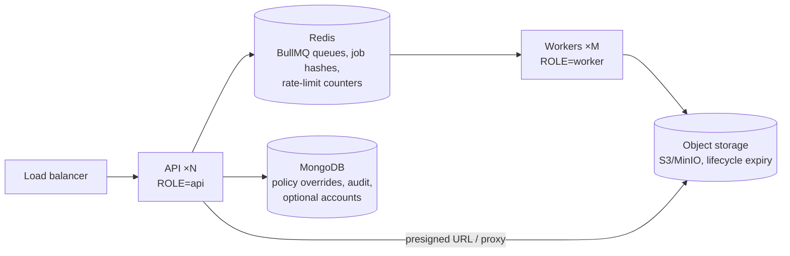
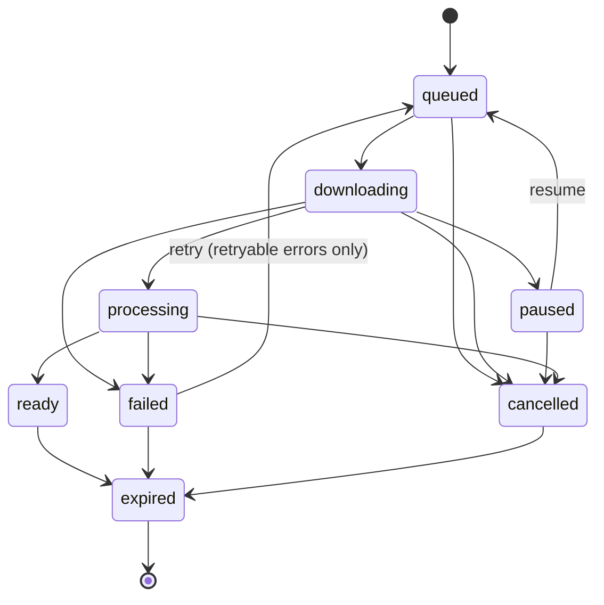

# System Architecture — Ferry

> Ferry is a self-hostable, compliance-first universal media downloader.
> A user pastes a link; Ferry detects the source, checks the platform policy,
> analyzes the available media, lets the user pick an output, and delivers the
> file in the requested format and quality.

Status: **implemented (MVP, single-node)**. Sections marked _Scale-out_ describe
designed-but-not-yet-implemented drivers. See `IMPLEMENTATION-ROADMAP.md`.

---

## 1. Goals and constraints

| Goal | How the architecture serves it |
|---|---|
| One input, zero friction | Client-side platform detection from a shared registry (no network round-trip), a single probe call, preset-driven format selection. |
| Honest capability reporting | Every option shown is derived from the probed formats. Sizes are shown only when the source reports them (or computed from a chosen bitrate × known duration, marked `≈`). |
| Compliance by construction | A policy registry gates every request *before* any media is fetched. DRM formats are dropped; protected platforms are never probed. |
| Security against hostile input | URL validation, an egress proxy that enforces public-IP-only connections for every engine, no shell execution, per-job sandbox directories, hard limits on time, size, and concurrency. |
| Never hold media in memory | Engines write to disk; delivery streams from disk with HTTP Range support. |
| Extensible | Platform adapters implement one interface; the registry maps hostnames to adapters and policies. |
| Runs anywhere | Default drivers need no external services (in-memory job store and queue, file-backed policy overrides). |

Non-goals for the MVP: user accounts, server-side history, livestream
recording, DRM'd or paywalled content (never a goal), browser extensions.

---

## 2. Technology decisions

| Layer | Choice | Why | Alternatives considered |
|---|---|---|---|
| Frontend | React 19 + Vite + Tailwind CSS v4 + React Router | Requested baseline; Vite gives sub-second HMR and small production bundles; Tailwind v4 CSS-first tokens keep the design system in one file. | Next.js (SSR is unnecessary for a single-input tool and complicates self-hosting). |
| Client state | Zustand (+ `persist`) | ~1 KB, no boilerplate, selector-based re-renders; enough for settings, history and the download manager. | Redux Toolkit (heavier, more ceremony for three small stores). |
| API | Node.js 24 + Express 5 | Requested baseline; Express 5 handles async errors natively. | Fastify (faster, but the request volume here is dominated by media work, not routing). |
| Validation | zod | Declarative request schemas with readable errors. | Hand-written validators. |
| Logging | pino (JSON) | Structured, fast, redaction support. | console. |
| Extraction | **yt-dlp** CLI (subprocess) | Broadest maintained coverage (≈1,800 extractors incl. a generic extractor for direct media and embedded players), DRM detection, Unlicense. | Streamlink (live; planned), Cobalt (AGPL service, ~20 services). |
| Image galleries | **gallery-dl** CLI (subprocess, GPL-2.0) | Photo posts, albums and carousels that yt-dlp does not cover (Imgur, Flickr, Mastodon, DeviantArt…); JSON metadata output and file-index selection. Run as a separate program only (mere aggregation). | yt-dlp (video-centric: its Imgur/Flickr extractors skip photos). |
| Official APIs | Internet Archive metadata API, PeerTube REST API | Category-1 sources where an official, permitted download route exists — preferred over scraping. | — |
| Processing | **FFmpeg / ffprobe** CLI | Industry standard; every target container/codec available. | — |
| Queue | In-process priority queue (default) | Zero dependencies for single-node deployments; same interface as a BullMQ driver. | BullMQ + Redis (_Scale-out_). |
| Job store | In-memory with TTL (default) | Jobs are ephemeral by design (files expire in ≤ 60 min). | Redis hashes / MongoDB TTL collection (_Scale-out_). |
| Policy overrides | JSON file with atomic writes + hot reload | Operators can disable or restrict a platform at runtime without redeploying. | MongoDB collection (_Scale-out_). |
| Tests | `node:test` (unit + integration), Playwright (E2E, system Edge/Chrome channel) | No test-framework dependency for the backend; Playwright drives real browsers without downloading browser binaries. | Jest/Vitest. |

### 2.1 Why yt-dlp runs as a subprocess of a Node worker (not a Python service)

* **Isolation:** each extraction is a separate OS process with its own timeout,
  priority, environment and working directory. A hang or crash cannot take
  down the API.
* **One language in the service layer:** the queue, policy engine, and API share
  code (`@ferry/shared`) with the web client.
* **Independent upgrades:** yt-dlp ships fixes every few weeks; it is upgraded
  with `pip` without touching application code.
* **Cost:** ~0.3–0.6 s Python start-up per invocation and a second extraction
  (probe, then download). Acceptable for MVP throughput. If it becomes a
  bottleneck, a Python worker that embeds yt-dlp as a library can implement
  the same queue contract (BullMQ has a Python client) without API changes.

---

## 3. Repository layout

```
download-link/
├─ packages/shared/        @ferry/shared — runtime-agnostic ESM, zero dependencies
│  └─ src/
│     ├─ platforms/catalog.js   platform registry data (≥100 platforms)
│     ├─ platforms/policy.js    policy classes, resolution, attestation rules
│     ├─ url.js                 parsing, normalization, tracking-param removal, detection
│     ├─ formats.js             containers, codecs, audio formats, bitrates, quality ladder
│     ├─ errors.js              error codes → user-facing copy, retryability
│     ├─ jobs.js                job states and allowed transitions
│     └─ filename.js            filename templates and sanitization
├─ apps/server/            @ferry/server — Express API + worker (roles: all | api | worker)
│  └─ src/
│     ├─ config.js              env parsing and validation
│     ├─ app.js                 Express app factory (used by tests)
│     ├─ main.js                process entry point
│     ├─ routes/                REST endpoints (v1)
│     ├─ middleware/            request id, rate limit, error mapping, security headers
│     ├─ security/              IP classification, URL guard, egress proxy, tokens
│     ├─ policy/                registry + runtime overrides
│     ├─ adapters/              platform adapters (yt-dlp, direct, archive.org, peertube)
│     ├─ engines/               safe process runner, yt-dlp + ffmpeg + ffprobe wrappers
│     ├─ media/                 probe normalization, format planner, size estimation
│     ├─ jobs/                  job store, queue, service, worker processors
│     └─ storage/               job directories, disk guard, cleanup sweeper, delivery
├─ apps/web/               @ferry/web — React SPA (+ PWA manifest, service worker)
├─ e2e/                    Playwright end-to-end tests
├─ deploy/                 Dockerfile, docker-compose, Caddyfile
└─ docs/                   this documentation set + research notes
```

---

## 4. Runtime topology

### 4.1 Single node (implemented)

```mermaid
flowchart LR
  U[Browser / PWA] -- HTTPS --> RP[Reverse proxy<br/>Caddy: TLS, HTTP/2]
  RP --> API[Ferry API<br/>Express]
  API -- in-process --> Q[(Job queue<br/>+ job store)]
  Q --> W[Worker loop]
  W -- spawn, no shell --> YT[yt-dlp]
  W -- spawn, no shell --> FF[ffmpeg / ffprobe]
  YT -- all traffic via --proxy --> EP[Egress guard proxy<br/>127.0.0.1, auth]
  API -- guarded agent --> EP2[Guarded HTTP agent]
  EP --> NET((Public internet))
  EP2 --> NET
  W --> FS[(Job directories<br/>DATA_DIR/jobs/:id)]
  API -- stream + Range --> FS
```

`ROLE=all` runs the API, the worker loop, and the egress guard in one Node
process. Media work never happens in the Node event loop: it happens in child
processes, so the API stays responsive under load.

### 4.2 Scale-out (designed, not implemented)



Required driver work is isolated behind three interfaces (`JobStore`,
`JobQueue`, `OutputStorage`) and one optional (`PolicyStore`). The API and worker
code paths do not change.

---

## 5. The request pipeline

| # | Stage | Where | Notes |
|---|---|---|---|
| 1 | URL validation | client + `shared/url.js`, server `security/urlGuard.js` | Syntax, scheme (`http`/`https` only), no credentials, length ≤ 2 048, port allowlist. |
| 2 | Platform detection | `shared/url.js#detectPlatform` | Hostname-suffix match against the registry; path-pattern match for federated platforms (PeerTube); falls back to `generic`/`direct`. |
| 3 | Policy & capability check | `server/policy/registry.js` | Registry default + runtime override → `allowed`, `attestation`, `export_only`, `blocked`, `disabled`. Blocked sources are never fetched. |
| 4 | Metadata extraction | adapter `probe()` | yt-dlp `--dump-single-json` (or official API) through the egress guard; 45 s timeout. |
| 5 | Format discovery | `media/normalize.js` | DRM formats and non-HTTP protocols removed; codecs normalized; available qualities computed from the smaller frame dimension (portrait-safe). |
| 6 | User selection | web `FormatPicker` | Only real options are rendered; presets map to selections. |
| 7 | Job creation | `POST /api/v1/jobs` | Selection validated against the cached probe; policy re-checked; per-client and global limits enforced; access token issued. |
| 8 | Queue | `jobs/queue/local.js` | Priority FIFO, global concurrency, queue-length cap. |
| 9 | Media download | adapter `download()` | yt-dlp writes into the job directory; progress parsed from a JSON progress template. |
| 10 | FFmpeg conversion | `engines/ffmpeg.js` | Remux when codecs fit the container; transcode only the incompatible streams; `-protocol_whitelist file,pipe`. |
| 11 | Temporary storage | `storage/jobFiles.js` | `DATA_DIR/jobs/<uuid>/`, created 0700; size-capped while downloading. |
| 12 | Delivery | `GET /api/v1/jobs/:id/files/:fileId` | `sendFile` with Range/ETag, `Content-Disposition: attachment` (RFC 5987), `nosniff`, sandbox CSP. |
| 13 | Cleanup | `storage/sweeper.js` | Expired jobs deleted every 60 s; orphan directories removed at start-up; optional delete-after-save. |

---

## 6. Platform registry and policy engine

The registry (`packages/shared/src/platforms/catalog.js`) is the single source
of truth for detection, policy, the in-app *Platforms* page, and the generated
`docs/PLATFORM-COMPATIBILITY.md`.

```js
{
  id: 'peertube',
  name: 'PeerTube',
  kind: 'video',                      // social | video | live | audio | podcast | education | ...
  hosts: [],                          // exact/suffix hostnames; federated platforms use `patterns`
  patterns: [/\/w\/[0-9A-Za-z]{22}\b/, /\/videos\/watch\/[0-9a-f-]{36}/],
  content: ['video', 'playlist', 'subtitles'],
  engine: 'peertube-api',             // preferred adapter; falls back to 'yt-dlp'
  category: 1,                        // 1..5 (see below)
  policy: 'allowed',                  // default runtime behaviour
  auth: 'none',
  officialApi: 'PeerTube REST API',
  routes: [{ label: 'Download button on the video page (when enabled by the uploader)', url: null }],
  restrictions: 'Respects the per-video downloadEnabled flag.',
  reliability: 'verified',            // verified | experimental | unstable | unsupported
  lastChecked: '2026-11-24',
}
```

### 6.1 Categories → runtime behaviour

| Category | Meaning | Default policy | User experience |
|---|---|---|---|
| 1 | Officially supported downloads | `allowed` | Normal flow. |
| 2 | Authorized user-owned content exports | `export_only` | Explains the official export route (e.g. "Download your information"); no extraction. |
| 3 | Public media with permitted downloading | `allowed` | Normal flow; license shown when known. |
| 4 | Technically supported, permission-restricted | `attestation` | Preview allowed; download requires the user to confirm they own the content or have the rights holder's permission. The platform's official route is shown. |
| 5 | Unsupported or protected (DRM, paywall, login) | `blocked` | Never probed. Explains why and links to the official offline option when one exists. |

`generic` (unknown sites and direct file links) defaults to `attestation` with
a one-time acknowledgement remembered in the client settings; the server still
requires `attest: true` on every job.

### 6.2 Runtime overrides

`DATA_DIR/policy-overrides.json` (written atomically via temp-file + rename,
re-read on change) or the admin API (`PUT /api/v1/admin/policies/:id`) can set
any platform to `allowed | attestation | export_only | blocked | disabled` with
a reason shown to users. A `*` override acts as a global kill switch. No
deployment is needed; `GET /api/v1/platforms` reflects the change immediately
and carries an `ETag` so clients refresh cheaply.

---

## 7. Platform adapter architecture

```js
/** @typedef {object} PlatformAdapter */
export default {
  id: 'yt-dlp',
  /** Return true if this adapter can handle the detected platform/URL. */
  supports(platform, url) {},
  /** Fetch metadata → normalized MediaInfo (no media bytes). */
  async probe(url, ctx) {},
  /** Download the selected streams into ctx.workDir; report progress. */
  async download(plan, ctx) {},
};
```

`ctx` provides: the egress proxy URL, the job directory, an `AbortSignal`,
`onProgress(progress)`, limits, and a logger. Adapters never spawn processes
themselves; they call `engines/process.js#run()` which enforces the no-shell,
timeout, priority, and kill-tree rules.

Built-in adapters:

| Adapter | Used for | Notes |
|---|---|---|
| `yt-dlp` | Every yt-dlp-supported site, including the generic extractor | Default. |
| `direct` | `http(s)` links whose path/Content-Type is a media file | Streams through the guarded agent; size checked from `Content-Length` and while streaming; `ffprobe` runs on the local file. |
| `internet-archive` | `archive.org/details/<id>` | Official metadata API; lists original + derivative files. |
| `peertube` | PeerTube instances | Official REST API; honours `downloadEnabled`. |
| `gallery-dl` | Registry entries with `engine: 'gallery-dl'` (Imgur, Flickr, Mastodon, …) | Image posts, albums and carousels → `kind: 'gallery'` (§8.5). Direct video/audio file links on those hosts still go to `direct`. |

**Adding a platform** = add a registry entry (hostnames, category, policy,
routes). If yt-dlp already supports it, nothing else is needed. If it has an
official download API, add an adapter module and set `engine` in the entry;
the download engine, planner, queue and UI are unchanged.

---

## 8. Media processing architecture

### 8.1 Normalized `MediaInfo`

```js
{
  kind: 'video' | 'audio' | 'playlist' | 'gallery',   // gallery: §8.5
  title, uploader, durationSec, uploadDate, webpageUrl, thumbnailUrl (signed proxy),
  isLive, license?, extractor,
  video: { qualities: [{ res: 1080, label: '1080p Full HD', fps: 60, hdr: false, codecs: ['vp9','h264'], sizeBytes?: n, sizeApprox: bool }] },
  audio: { tracks: [{ id, codec: 'opus', abrKbps: 129, language? }], best: {...} },
  subtitles: [{ lang: 'en', name: 'English', auto: false, formats: ['vtt','srt'] }],
  entries?: [{ id, title, durationSec, url }],     // playlists (capped)
  capabilities: { modes: ['av','video','audio'], containers: [...], audioFormats: [...] },
}
```

Raw format URLs never leave the server.

### 8.2 Planner (`media/planner.js`)

Input: `MediaInfo` (+ raw formats) and the user selection
`{ mode, video: { container, quality }, audio: { format, bitrate }, extras }`.

1. **Pick streams** — highest-ranked video format with `res ≤ requested`, preferring
   codecs the target container accepts natively; best audio-only format,
   preferring a codec that can be copied; fall back to the best combined format.
2. **Build the yt-dlp selector** — exact format ids with a resilient fallback
   (`137+140/bv*+ba/b`) plus `-S res:<n>`; merge into MKV (accepts every codec)
   unless the target container already fits the codecs.
3. **Build the FFmpeg step** — per stream: `copy` if compatible, otherwise the
   target encoder. Audio-only conversions copy when the source codec already
   matches the target and the user chose *Source* bitrate.
4. **Estimate** — bytes from source sizes or `bitrate × duration`; flags
   `transcode: true` with a human reason ("WebM needs VP9 — re-encoding 1080p
   H.264 is slow").

### 8.3 Container/codec compatibility

| Target | Copy if video ∈ | Copy if audio ∈ | Otherwise encode to |
|---|---|---|---|
| MP4 | h264, hevc, av1, vp9 | aac, mp3, opus, ac3, eac3, alac, flac | libx264 / aac |
| WebM | vp8, vp9, av1 | opus, vorbis | libvpx-vp9 / libopus |
| MKV | any | any | — |
| MOV | h264, hevc, mpeg4 | aac, alac, mp3, pcm | libx264 / aac |
| AVI | mpeg4 | mp3, ac3, pcm | mpeg4 (xvid tag) / libmp3lame |

| Audio target | Encoder | Container | Copy when source is |
|---|---|---|---|
| MP3 | libmp3lame (CBR) | mp3 | mp3 |
| M4A | aac | ipod (MP4 audio) | aac |
| AAC | aac | adts | aac |
| WAV | pcm_s16le | wav | — (always decoded) |
| FLAC | flac | flac | flac |
| Opus | libopus | Ogg Opus | opus |
| OGG | libvorbis | ogg | vorbis |

VP9 re-encodes use `-deadline realtime -cpu-used 7 -row-mt 1 -tile-columns 2`:
about 11× faster than `good/5` for ~19% more bytes at the same CRF (measured).
All FFmpeg runs carry `-max_alloc 512M` and `-protocol_whitelist file,pipe`.

**Quality honesty rules** (enforced in planner and UI):
* Qualities above the source's best are never offered (no upscaling).
* Bitrates above the source bitrate are allowed but labelled
  "larger file, no quality gain".
* WAV/FLAC from lossy sources are labelled "lossless container — quality
  matches the source".

### 8.4 Progress model

| Phase | Source of truth | Percent |
|---|---|---|
| `queued` | queue position | none (position shown) |
| `downloading` | yt-dlp JSON progress template (`downloaded_bytes`, `total_bytes`/`total_bytes_estimate`, `speed`, `eta`, fragments) | bytes ratio when a total is known; otherwise fragment ratio; otherwise indeterminate |
| `processing` | `ffmpeg -progress pipe:1` (`out_time_us`) ÷ known duration | ratio, or indeterminate when duration unknown |
| `finalizing` | ffprobe verification | indeterminate |

Multi-stream downloads (video then audio) are weighted by their reported
sizes. No synthetic progress is ever generated.

### 8.5 Image galleries (gallery-dl)

Platforms whose registry entry says `engine: 'gallery-dl'` are handled by
`adapters/galleryDl.js` (argument building and output parsing live in
`engines/galleryDl.js`). gallery-dl only ever runs through
`engines/process.js#runProcess`: argv array, no shell, the URL after `--`,
minimal environment, hard timeout and stall watchdog.

**Hardened profile (every run):** `--config-ignore` (no config files),
`--no-input`, `--proxy <per-job egress credentials>` with
`-o proxy-env=false`, `-o browser=false -o tls12=true` (no browser header/TLS
imitation — the same no-impersonation rule as yt-dlp), `--cache-file` inside the job's
temp directory, `--http-timeout 30 -R 3`. Never `--exec`, cookies,
`--username`/`--password`, `--netrc`, `-c`/`--config*` or post-processors
other than the stdout marker below.

**Probe** — `gallery-dl -j --range 1-<MAX_GALLERY_ITEMS+1> -- <input>`:

1. The JSON message list (`[2, post]`, `[3, url, file]`, `[6, url, child]`,
   `[-1, {error, message}]`) is parsed. A file becomes a gallery item only if
   its URL is `http(s)` **and** its extension is an image
   (jpg/jpeg/png/gif/webp/avif). Videos, `ytdl:` embeds (e.g. a YouTube
   player inside a Behance project) and text blocks are counted and skipped —
   they never reach yt-dlp through gallery-dl.
2. Child URLs (`[6, …]`) are followed **once**, by a second probe, only when
   the result has no files of its own and Ferry's registry maps the child URL
   to the *same* platform (Imgur's `/gallery/<id>` → `/a/<id>`). Links to
   other sites are reported as skipped, never followed.
3. Federated Mastodon URLs (detected by path pattern on any server) are passed
   as `mastodon:<url>` so gallery-dl's Mastodon API extractor accepts any
   instance.
4. The result is normalized to `kind: 'gallery'`:
   `gallery: { items: [{ index, ext, width, height, sizeBytes, previewUrl }], truncated, skipped: { videos, other, links } }`.
   `index` is the file's 1-based position in gallery-dl's output; preview
   images go through the signed thumbnail proxy. Item URLs stay server-side.

Policy handling matches the yt-dlp path: the effective policy is checked
before gallery-dl runs, `attestation` platforms need the user's confirmation
when the job is created, and the policy is applied again when a job starts
(queued, paused or retried jobs follow runtime overrides). gallery-dl only runs
the platform's own extractor (no links to other sites), and files hosted on a
platform whose policy does not allow downloads are never offered.

**Job request** — `{ mode: 'gallery', gallery: { items: [1, 3, 4] } }`; every
index must exist in the probe.

**Download** — the same input (the followed child URL when step 2 applied)
with `--range 1,3,4`, `--filter True` (any file filter stops extractors from
fast-forwarding by *posts* — DeviantArt does — so indexes count files exactly as in
the probe), `--child-filter False` (no child extractors),
`-o downloader.ytdl.enabled=false`, `-D <tmp>/gallery`,
`--restrict-filenames ascii`, `--filesize-max <MAX_IMAGE_MB>` and
`--Print "prepare:FERRY_GDL_FILE -"` (a constant line). gallery-dl downloads in index
order and prints the marker before each file and the saved path after each
success, so marker *k* belongs to the *k*-th selected index; a missing path
line means that file failed. The egress proxy enforces the job's byte cap, and a file larger than
`MAX_IMAGE_MB` is dropped even when the server sent no `Content-Length`.

**Finalize (per image)** — magic-byte sniff (`adapters/http.js#sniffImage`;
anything that is not JPEG/PNG/GIF/WebP/AVIF is rejected), ffprobe (one image
stream, at most `MAX_IMAGE_MEGAPIXELS`), then an FFmpeg re-encode with
`-map_metadata -1` using built-in encoders only:

| Source | Output |
|---|---|
| JPEG | JPEG (`-q:v 2`), turned upright from its EXIF orientation |
| PNG, lossless WebP, any image with alpha | PNG |
| GIF (still or animated) | GIF (a palette per frame, so memory stays flat) |
| Lossy WebP, AVIF (no alpha) | JPEG |
| Animated WebP / APNG | GIF |

Animations are limited to 2 Gpx decoded in total (frames × width × height):
longer GIFs are refused, and APNG/WebP animations stop there. The output is
probed again before it is offered. Files are named
`<template> - 01.jpg`, `<template> - 02.png`… (the number is the item's
position in the gallery) and the existing `/archive` route streams them as
`<template>.zip`. Some images failing is not fatal (note `gallery-partial`);
none succeeding fails the job with the classified error.

---

## 9. Job lifecycle



Transitions are defined once in `@ferry/shared/jobs.js` and enforced by the job
store; an illegal transition throws. `attempt` increments on retry (max 3).
Pause terminates the engine process but keeps partial files, so resume
continues from where it stopped (yt-dlp `--continue`).

---

## 10. Queue and workers

* **Local queue:** binary-heap priority queue (priority, then FIFO sequence).
  Global concurrency `MAX_CONCURRENT_JOBS` (default 2 on a 2-core host).
  Queue length cap `MAX_QUEUE_LENGTH` → `QUEUE_FULL` (HTTP 503 + `Retry-After`).
* **Probes** are not queued; they run under a separate semaphore
  (`MAX_CONCURRENT_PROBES`) with a short wait, because users are waiting on them.
* **Per-client fairness:** a client key (HMAC of the IP address, IPv6 grouped by
  /64) may hold at most `MAX_ACTIVE_JOBS_PER_CLIENT` non-terminal jobs.
* **Cancellation:** every running job owns an `AbortController`; abort kills the
  whole process tree (`taskkill /T /F` on Windows, process-group `SIGKILL` on
  POSIX).
* **Timeouts:** per stage (probe 45 s, download/convert `JOB_TIMEOUT_MS`), plus a
  stall watchdog (no progress for 120 s → `DOWNLOAD_INTERRUPTED`, retryable).
* **CPU:** engines run at below-normal priority (`os.setPriority`) and FFmpeg is
  capped with `-threads`.

---

## 11. File storage strategy

* Job directory: `DATA_DIR/jobs/<uuid>/` — the only place an engine may write.
  Paths are built from the server-generated UUID only; user-visible names are
  applied in `Content-Disposition`, never on disk.
* Disk guard: a job is not started if free space < `MIN_FREE_DISK_MB` or total
  job storage > `MAX_STORAGE_MB` (`INSUFFICIENT_STORAGE`, retryable).
* Size guard: yt-dlp `--max-filesize` plus a directory-size watchdog during
  download (covers HLS/DASH where size is unknown up front).
* Retention: `ready` files expire after `JOB_TTL_MINUTES` (default 60). Users can
  delete immediately; the client can do it automatically after saving.
* Start-up: all job directories are removed (jobs are in-memory, so leftovers
  are orphans).

---

## 12. Frontend architecture

* **Routes:** `/` (downloader), `/downloads`, `/history`, `/settings`,
  `/sites` (`/platforms` redirects there), `/share` (PWA share-target entry),
  `*` (not found).
* **Data flow:** detection runs on every keystroke with no network: the client
  builds the `@ferry/shared` registry from `GET /api/v1/platforms` (effective
  policies, path/pattern rules as regex sources), cached in local storage with its
  ETag — so operator overrides apply to the UI immediately and the 251-entry
  catalog never ships in the bundle. *Analyze* calls `POST /probe`; *Download* calls
  `POST /jobs` and stores `{ id, token }` locally. The download manager polls
  `POST /jobs/status` (one batched request, every 1 s while any job is active,
  backing off when the tab is hidden). Polling was chosen over SSE: it is
  stateless (scales horizontally), survives mobile backgrounding and proxies,
  and avoids the HTTP/1.1 six-connection limit.
* **Stores:** `settings` (persisted), `history` (persisted, capped at 500
  entries, opt-out in Settings), `downloads` (active jobs + tokens, persisted so
  a reload re-attaches to running jobs).
* **Design system:** the approved mockups are `design/ferry-redesign-mockups.html`.
  CSS variables in `styles/index.css` (sun yellow `#FFD43B` for "start here",
  ink, paper, canvas, four status colours), consumed by Tailwind v4
  `@theme inline`; Archivo variable font (width axis for the wide headings).
  Light/dark/system themes.
* **Site statuses:** `lib/siteStatus.js` maps each site's *effective* policy to one
  plain status (free to save, your own or with permission, official download
  only, protected, any other site, turned off here, not on this server yet) and
  groups them into the Home shelves. Statuses never come from extractor
  reliability: a reachable site is not an allowed one.
* **Site logos:** `scripts/make-brand-icons.mjs` vendors path data from Simple
  Icons (CC0) into `lib/brands/featured.js` (sites on Home, main bundle) and
  `lib/brands/all.js` (the rest, loaded on demand); sites without a logo get a
  letter tile. No icon package ships as a dependency and builds never touch the
  network.
* **Live status:** `state/liveStatus.js` reads `GET /api/v1/status` (at most every
  30 s, failures silent) and shows a dot only when the server has data: green
  working, orange some links fail, red failing; the copy names the real window
  (last hour, or last 24 hours when the last hour is quiet).
* **Copy:** English only. Every string lives in `lib/i18n/en.js`, read through
  `t()`, so the same thing is always called the same.
* **Code splitting:** the analysis workspace, playlist/batch/gallery panels and
  secondary screens are separate chunks, prefetched as soon as a link is typed
  (initial JS 145 KB gzip including the Home logos, see `PERFORMANCE.md`).
* **PWA:** web manifest with a share target (Android), a small service worker
  that caches the app shell only (never API responses or media).

---

## 13. Error-handling strategy

* Every failure maps to a code in `@ferry/shared/errors.js` with user-facing
  copy, an HTTP status, and `retryable`.
* Engine stderr is classified (`engines/classify.js`) into those codes; raw
  stderr is logged at `debug` only and never sent to clients.
* Retry is offered only for `retryable` codes (network, timeout, source rate
  limit, storage, queue full) and is capped at 3 attempts.
* The API error envelope is always `{ error: { code, message, retryable, requestId } }`.

---

## 14. Observability

* Structured JSON logs (pino) with a request id (`X-Request-Id`), method,
  route, status, and duration. Query strings, tokens, and full media URLs are
  redacted; media URLs are logged as `platformId` + salted hash.
* Job events (`created`, `started`, `ready`, `failed`, `cancelled`, `expired`)
  are logged with platform, mode, bytes, durations, and error code.
* `GET /api/v1/admin/metrics` exposes Prometheus counters/gauges (jobs by
  status, queue depth, active engines, bytes served, probe latency buckets,
  failures by platform). Admin endpoints require `ADMIN_TOKEN`.
* `GET /healthz` (liveness) and `GET /readyz` (engines present, disk OK).

---

## 15. Security architecture (summary)

Full threat model and test evidence: `SECURITY-AUDIT.md`.

* **SSRF / DNS rebinding:** the URL guard validates input; the **egress guard
  proxy** resolves every outbound connection itself, rejects non-public
  addresses, pins the validated IP, and only allows HTTP(S) to allowlisted
  ports. yt-dlp is forced through it (`--proxy`), FFmpeg never touches the
  network, and the API's own fetches use a guarded `lookup`.
* **Command/option injection:** `spawn(file, argv, { shell: false })` only; the
  URL is passed after `--`; every other argument is server-generated from
  allowlisted enums or validated format ids.
* **Engine hardening:** yt-dlp `--ignore-config`, no plugins, no `--exec`, no
  cookies, no impersonation; FFmpeg `-protocol_whitelist file,pipe`; minimal
  child environment (no secrets).
* **Files:** UUID paths, containment checks, sanitized download names,
  `nosniff`, sandbox CSP, per-job access tokens (SHA-256 hashed at rest).
* **Abuse:** rate limits, per-client active-job caps, queue cap, size/duration
  limits, timeouts, disk guard, TTL cleanup.

---

## 16. Deployment architecture

* **Container:** `deploy/Dockerfile` (multi-stage): builds the web app, then a
  `node:24-bookworm-slim` runtime with Python 3, a pinned yt-dlp, and Debian
  FFmpeg. Runs as an unprivileged user with a read-only root filesystem;
  `DATA_DIR` is a dedicated volume.
* **Compose:** `deploy/docker-compose.yml` sets CPU/memory/pids limits,
  `cap_drop: [ALL]`, `no-new-privileges`, and puts Caddy in front for TLS and
  HTTP/2.
* **Network defence in depth:** block RFC 1918, link-local (incl.
  `169.254.169.254`), and loopback egress from the container network at the
  host firewall (`DOCKER-USER` chain), in addition to the in-app egress guard.
* **Upgrades:** yt-dlp is pinned in the image and bumped by rebuilding; the
  admin `readyz` endpoint reports engine versions.
* **Vercel (trial):** `Dockerfile.vercel`, kept identical to `deploy/Dockerfile`
  by `apps/server/test/unit/vercel-deploy.test.js`, runs the same image on
  Vercel's container runtime (beta) with the settings in
  `deploy/vercel.env.example`: `PORT=8787`, `DATA_DIR` under `/tmp`, one
  trusted proxy hop and lower limits. Jobs and files live in one running copy
  (in-memory store, local disk), and Vercel may start more copies or stop an
  idle one, so this is a trial rather than a production deployment (README,
  "Deploy on Vercel").

---

## 17. Performance and scalability

| Concern | Approach |
|---|---|
| Large files | Disk-only pipeline; Range delivery; no buffering in Node. |
| High resolution | Prefer stream copy; transcode only incompatible streams; warn before slow transcodes. |
| Concurrent users | Probes bounded by a semaphore; jobs bounded by queue + concurrency; polling responses are tiny. |
| CPU-heavy work | Below-normal priority, `-threads` cap, concurrency default = physical cores. |
| Bandwidth | Optional `--limit-rate` per job; `--concurrent-fragments` for HLS/DASH. |
| Storage | TTL cleanup, delete-after-save, storage caps, disk guard. |
| Horizontal scale | Swap in BullMQ/Redis + S3 drivers; API stays stateless (polling, tokens). |

---

## 18. Decision log

| # | Decision | Rationale |
|---|---|---|
| ADR-1 | Monorepo with `@ferry/shared` used by client and server | One registry, one set of error codes, one filename sanitizer. |
| ADR-2 | yt-dlp as a subprocess, not a library | Isolation, upgradability, one service language. |
| ADR-3 | Egress guard proxy for all engine traffic | Only robust SSRF/DNS-rebinding defence for a tool that fetches arbitrary URLs. |
| ADR-4 | Polling instead of SSE/WebSocket | Stateless, mobile-robust, proxy-friendly. |
| ADR-5 | History and settings stay on the device | Privacy by default; no accounts needed for the MVP. |
| ADR-6 | In-memory/file drivers by default; Redis/Mongo as drivers | Runs with zero infrastructure; scale-out does not change application code. |
| ADR-7 | Policy registry with runtime overrides | Compliance changes ship without a deployment. |
| ADR-8 | No cookies, logins, or impersonation | Never bypass access controls or anti-bot systems; never handle third-party passwords. |
| ADR-9 | Image galleries through gallery-dl as a separate program, images only | GPL-2.0 engine kept at arm's length (mere aggregation); images are easy to prove and re-encode, while videos and embeds would bypass the yt-dlp policy path; FFmpeg built-in encoders only, so output never depends on optional libraries (§8.5). |
